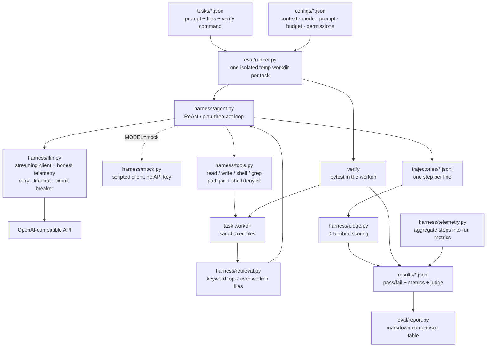

# mini-harness-bench

A from-scratch coding agent harness with built-in inference telemetry and a
tiny eval suite — built to study how harness design decisions affect both task
success and inference cost.

Motivation: I build production AI agents by day; this is my lab for going one
layer deeper into the harness itself — the loop, the tools, the context
management — and measuring what each choice costs in latency and tokens.

## What it does

- **Minimal ReAct harness** (`src/harness/`): system prompt, tool-calling loop
  (`read_file`, `write_file`, `run_shell`, `grep`), sandboxed per-task workdir,
  trajectory logging to JSONL.
- **Inference telemetry** (`src/harness/llm.py`, `telemetry.py`): per-call
  **TTFT**, **call latency**, **effective throughput (tok/s)** and token usage,
  measured over a streaming OpenAI-compatible API. Only honest, client-side
  measurable metrics are reported — per-token timings derived from chunk
  arrival times are deliberately excluded (the API batches many tokens per
  chunk, so those numbers measure network batching, not model speed).
- **Reliability** (`src/harness/llm.py`, `agent.py`): retries with exponential
  backoff + jitter on transient API failures, request timeouts, a circuit
  breaker after repeated consecutive failures, graceful degradation
  (failed runs record a `stop_reason` instead of crashing the eval), and
  optional per-task token budgets (wrap-up warning at 80%, hard stop at
  the cap).
- **Guardrails** (`src/harness/tools.py`): file tools are jailed to the task
  workdir; shell commands matching a destructive denylist (`rm -rf`,
  `sudo`, piping downloads into a shell, `mkfs`, raw device writes) are
  refused before execution, and a `readonly` permission mode disables
  writes and shell entirely. Refusals reach the agent as tool results and
  are counted in telemetry as `guardrail_blocks`. Note: this is a safety
  net, not a sandbox — shell still runs as your user and can be bypassed,
  so never describe guardrails as sandboxing.
- **RAG-style file context** (`src/harness/retrieval.py`): with
  `context_strategy: "retrieved"`, the harness scores workdir files by
  keyword overlap with the task prompt and injects the top-k into the
  task message up front — the agent starts with the modules it needs
  instead of discovering them one `read_file` at a time. Test files are
  excluded from retrieval. Honest accounting: this trades per-turn read
  calls for upfront prompt tokens, so the win is fewer tool round-trips
  and less wandering through irrelevant files, not necessarily fewer
  total tokens.
- **KV-cache-friendly prompt layout**: prefix caching matches on exact
  token sequences, so variable content early in the message list poisons
  the cache for everything after it. Two concrete moves: retrieved files
  can be injected in `path` order (`retrieval_order: "path"`) instead of
  score order, so the same file set always yields the same prefix bytes;
  and the sliding-window trim notice is appended at the end of the
  message list instead of after the task prompt, so it only costs itself.
  Per-call cached tokens are read from the API usage payload
  (`prompt_tokens_details.cached_tokens`) into telemetry as
  `cached_tokens` / `cache_hit_rate` — mock runs report 0, honestly, since
  no real cache exists there; the layout comparison is a live experiment.
- **Eval runner** (`src/eval/runner.py`): runs each task in an isolated temp
  dir, grades with the task's `verify` command, records pass/fail + metrics.
- **LLM-as-judge** (`src/harness/judge.py`): with `--judge`, each finished
  trajectory is also scored 0–5 on a rubric (solution correctness, tool
  efficiency, verification discipline, recovery) — pytest says *whether* it
  worked, the judge says *how well*.
- **Config experiments** (`configs/`): compare harness knobs head-to-head —
  e.g. `full` history vs `sliding_window` context trimming, pure ReAct
  vs plan-then-act (`configs/plan.json`: one tool-less planning call, then
  execution against the plan; planning failures degrade back to ReAct),
  cheap→strong model tiering (`configs/tiered.json`: start on the cheap
  model, escalate on tool errors or long horizons; per-call model recorded
  in trajectory metrics), retrieved file context (`configs/retrieved.json`:
  top-2 files injected up front; the suite's 9th task,
  `checkout-with-distractors`, hides the two relevant modules among eight
  irrelevant ones to show it off — mock: 4 steps / 4 tool calls full vs
  3 steps / 2 tool calls retrieved; live numbers to come), and
  cache-friendly retrieval order (`configs/retrieved-path.json`: same
  retrieved strategy, files injected in path order so the prefix bytes
  are stable across runs).

## Architecture



One loop iteration: build messages → LLM call (records TTFT, latency,
tokens) → append the assistant message → execute tool calls
(guardrail-checked) → append tool results → apply the context strategy
(`full` keeps everything, `sliding_window` trims old messages without
splitting a tool-call group, `retrieved` injects top-k files up front and
then keeps full history) → repeat until DONE, the token budget, or the
iteration cap.

## CI

`.github/workflows/eval.yml`: every push and PR runs the mock suite under
the serial, sliding, and retrieved configs and fails the build if any task
fails — no API key needed. A live run is manual only: Actions → eval →
Run workflow, pick a config, and it runs against the real API using the
`OPENAI_API_KEY` repo secret (set it in Settings → Secrets before the
first live dispatch; it never runs on push).

## Quickstart

```bash
python -m venv .venv && source .venv/bin/activate
pip install -r requirements.txt
cp .env.example .env   # add your OPENAI_API_KEY (any OpenAI-compatible endpoint)

# run the sample tasks with the baseline harness
python -m src.eval.runner --config configs/serial.json

# run again with sliding-window context, then compare
python -m src.eval.runner --config configs/sliding.json --out results/results_sliding.jsonl
cat results/results.jsonl results/results_sliding.jsonl > results/all.jsonl
python -m src.eval.report --results results/all.jsonl
```

### Offline mock mode (no API key)

`MODEL=mock` swaps the OpenAI client for a scripted one
(`src/harness/mock.py`) that streams canned tool-call plans for the sample
tasks through the exact same response-parsing and telemetry code path as the
real client. Use it to smoke-test the harness, the eval runner, and the
report without spending tokens:

```bash
MODEL=mock python -m src.eval.runner --config configs/serial.json --out results/mock_serial.jsonl
MODEL=mock python -m src.eval.runner --config configs/sliding.json --out results/mock_sliding.jsonl
python -m src.eval.report --results results/mock_serial.jsonl
```

The mock is deterministic — every sample task passes — so a green mock run
tells you the loop, tool sandbox, verify grading, and trajectory logging all
work; swap in your key (`MODEL=gpt-4o-mini`) when you want real model
behavior.

## Example results

Full-suite live runs (gpt-4o-mini, prompt v1, 8 tasks including one
multi-file task; judge = gpt-4o-mini, rubric average /5). Full-context ran
once (2026-10-20); sliding-window ran twice (2026-10-20 and 2026-10-21):

| config | tasks | pass rate | avg steps | avg TTFT (ms) | avg call latency (s) | effective throughput (tok/s) | avg tokens/task | judge avg |
|---|---|---|---|---|---|---|---|---|
| serial-full-context (run 1) | 8 | 88% | 5.5 | 935.1 | 1.28 | 29.7 | 4090 | 4.5 |
| serial-sliding-window (run 1) | 8 | 100% | 5.2 | 921.5 | 1.19 | 29.9 | 3150 | 4.8 |
| serial-sliding-window (run 2) | 8 | 100% | 5.9 | 892.1 | 1.27 | 27.5 | 3765 | 4.4 |

Reproduce with:

```bash
python -m src.eval.runner --tasks tasks/extended_tasks.json --config configs/serial.json --judge --out results/live-serial.jsonl
python -m src.eval.runner --tasks tasks/extended_tasks.json --config configs/sliding.json --judge --out results/live-sliding.jsonl
cat results/live-serial.jsonl results/live-sliding.jsonl > results/live-all.jsonl
python -m src.eval.report --results results/live-all.jsonl
```

Reading of these runs: sliding-window passed 8/8 in both runs and used
fewer tokens per task than full-context both times — but the margin moved
(3150 vs 4090 tokens in run 1, 3765 vs 4090 in run 2), and per-task
behavior swung widely. `count-errors` is the poster child: full-context
looped to the iteration cap and failed it (12 steps, 14.8k tokens, judge
1.5/5); sliding run 1 solved it cleanly (10 steps, judge 4.5); sliding
run 2 thrashed to the cap (12 steps, judge 1.0) yet still passed pytest —
pass/fail and trajectory quality are different axes, which is exactly why
the judge scores sit next to the test results. With n=8 and this much
run-to-run variance, treat every delta here as directional, not proven;
repeats and a bigger suite are needed before claiming a real tradeoff.

Note: the suite has since grown to 9 tasks (the RAG distractor demo), so
re-running the commands above today covers 9 tasks; the table above is
the 8-task runs as they happened.

This eval also caught a real harness bug: the first sliding-window run
crashed mid-suite with an OpenAI 400 — trimming was slicing an
assistant(tool_calls) → tool(result) group in half and orphaning the tool
messages. Fixed (trimming now never splits a tool group) and the API-error
path hardened so a non-retryable error degrades to a per-task `llm_error`
instead of killing the whole run; the table above is the post-fix rerun.

## Comparing configurations

Context strategies — the axis this project studies most:

| strategy | how it works | effect | best when | evidence |
|---|---|---|---|---|
| `full` (`configs/serial.json`) | keeps every message | baseline; prompt tokens grow with steps | short tasks, few files | live: 7/8, 4090 tok/task |
| `sliding_window` (`configs/sliding.json`) | keeps system + prompt + last 8 messages, never splits a tool-call group | fewer tokens/task in both live runs | long horizons | live: 8/8 twice, 3150 / 3765 tok/task |
| `retrieved` (`configs/retrieved.json`) | top-k files injected up front, then full history | fewer tool round-trips, not necessarily fewer total tokens | many-file workdirs | mock: 4→3 steps, 4→2 calls; live TBD |

Other knobs:

| knob | what it does | cost effect | evidence |
|---|---|---|---|
| plan-then-act (`configs/plan.json`) | one tool-less planning call, then execution against the plan | +1 call up front; may reduce wandering | mock 9/9; live A/B TBD |
| token budget (`configs/budget.json`) | wrap-up nudge at 80%, hard stop at the cap | bounds blowups (`count-errors` hit 14.8k uncapped) | mock-verified at cap 500 |
| model tiering (`configs/tiered.json`) | cheap model first, escalate on tool error or step 6 | fewer strong-model calls | mock-verified; live savings TBD |
| cache-friendly layout (`configs/retrieved-path.json`) | retrieved files in path order; trim notice at end of message list | stable prefix → higher cache-hit potential, measured via `cached_tokens` | mock-verified order; live cache numbers TBD |
| guardrails (`configs/readonly.json`) | shell denylist + readonly mode, blocks counted in telemetry | no model cost; tasks fail closed | mock: blocks counted, 0/9 in readonly |

## Context management: what I learned

Context is the agent's working memory, and every context choice trades
relevance against size against staleness. Three lessons from building
this harness:

**Trimming and retrieval are different axes, not substitutes.**
Sliding-window bounds how fast context *grows*; retrieval seeds what
context *starts with*. A long task in a big repo wants both — today
`retrieved` composes with full history only, so retrieved + sliding is
open future work, not a claimed combination.

**Messages are not independent lines; tool groups are atomic.** An
assistant message with `tool_calls` and its tool-result messages form one
unit. Trimming that splits the unit produces a conversation the API
rejects outright — this was a real crash in the first sliding run, not a
theoretical edge. Any trimming rule must respect the group boundary,
and the eval suite is what catches violations.

**Retrieval quality is about ranking, not recall.** Keyword overlap
works when files share vocabulary with the task (the distractor demo:
the two relevant modules rank top-2 out of ten). It fails when
relevance is semantic — a helper with an unrelated name, or a concept
the task describes but never names. Keyword retrieval is an honest
baseline; embeddings are the next step, not a skipped one.

**Prefix caching is a third axis.** Trimming bounds growth and retrieval
seeds relevance; prefix caching rewards *stability* — the same bytes in
the same order. That puts it in tension with both: sliding-window deletes
prefix tokens by design, and score-ordered retrieval reorders the prefix
per task. The two layout moves in this repo (path-ordered injection, trim
notice at the end) exist to reduce that tension, and `cached_tokens` in
telemetry exists to measure whether they actually help — a layout claim
without a cache-hit number is just a story.

**Measure with repeats, or don't claim a tradeoff.** The same
sliding-window config moved from 3150 to 3765 tokens/task across two
live runs, and one task swung from judge 4.5 to 1.0 while still passing
pytest. Context decisions change behavior stochastically, so this repo
reports pass/fail next to judge scores and treats every single-run
delta as directional.

A rough decision guide: few files and a short horizon → `full`; long
horizon → `sliding_window`; many files → `retrieved`; untrusted
commands → `readonly` plus a token budget.

## Metrics glossary

- **TTFT** — time to first chunk: how fast the model starts responding each turn.
- **Call latency** — full round-trip wall time per LLM call.
- **Effective throughput** — completion tokens / total call seconds: the speed
  the harness actually experienced (not derived from per-chunk arrival times).
- **Tokens/task** — the real cost driver for agentic workloads: every extra
  tool round-trip multiplies prompt tokens.
- **guardrail_blocks** — tool calls intercepted by guardrails (denylist or
  readonly mode) in a task.
- **model** — the model used for each call, recorded in trajectory metrics
  (tiered runs mix cheap and strong models).
- **cached_tokens / cache_hit_rate** — prompt tokens served from the
  provider's prefix cache, and their share of prompt tokens (0 on mock
  runs, which have no real cache).
- **stop_reason** — how a run ended: `done` | `max_iterations` | `llm_error` |
  `budget_exceeded` | `gave_up`.

## Roadmap

- [x] Honest telemetry (TTFT, call latency, effective throughput — no chunk-arrival artifacts)
- [x] Reliability: retries with backoff, timeouts, circuit breaker, graceful degradation
- [x] LLM-as-judge scoring with rubrics, alongside deterministic pytest grading
- [x] More tasks: multi-file refactors, longer horizons (9 total, incl. a distractor-file RAG demo)
- [x] Prompt versioning: prompt v1/v2 as an A/B config dimension
- [x] Plan-then-act vs pure ReAct: plan-then-act implemented as a config dimension (live A/B numbers to come)
- [x] Token budgets per task (80% wrap-up warning, hard stop at the cap; `configs/budget.json`)
- [x] Model tiering (cheap→strong escalation on tool errors or long horizons; per-call model in metrics)
- [x] Guardrails: shell denylist + readonly permission mode, blocks counted in telemetry
- [x] RAG-style file context (keyword top-k injection; distractor task demo; `configs/retrieved.json`)
- [x] CI: mock eval gate on push/PR, live eval manual-only via workflow_dispatch
- [x] Comparison tables: context strategies and other knobs, with evidence status per row
- [x] Context-management writeup: trimming vs retrieval, the tool-group invariant, ranking limits, measurement caveats
- [x] KV-cache-friendly prompt layout: path-ordered retrieval injection, trim notice at end, cached_tokens telemetry
- [ ] Parallel subagent config (fan-out independent tool calls, measure latency win vs token cost)
- [ ] Trajectory visualizer
